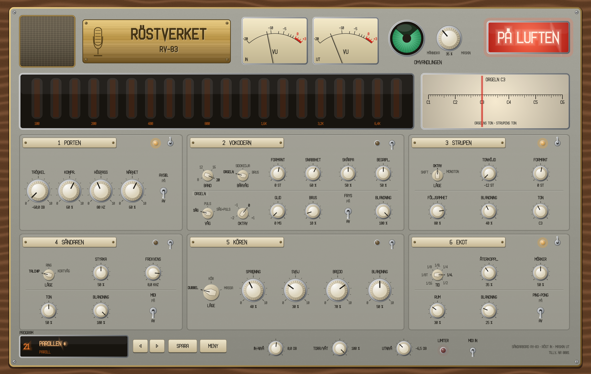
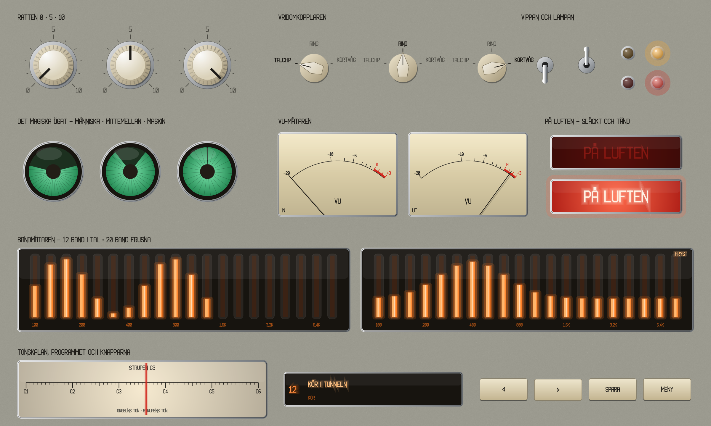

# Röstverket

*Modell RV-83. Sändarbordet i radiohuset* – en effekt som gör en röst till vokoder, robot, kör eller paroll.

Insert-effekt (VST3, AU, CLAP) med MIDI-ingång och sidokedja, och fristående app, för macOS. Syster till [Pannrummet](../pannrummet) och [Kroppsmaskinen](../kropps-maskinen).

**Status: fas 3 byggd (6 november 2026), väntar på grind 3 (1.0).** Alla sex moduler, Omvandlingen, 30 fabriksprogram, appen och manualen. Latensen är fast, 25 ms. Se [PLAN.md](PLAN.md).



## Manualer

- **[Manualen](docs/Manual.md)** – snabbstart, varje modul och reglage med bilder, Omvandlingen, programmen, appen, recept och felsökning.
- **[Röstverket i Reaper](docs/Rostverket_i_Reaper.md)** – insert, MIDI till Orgeln, sidokedjan, automation och testlåten.

**Kom igång:** lägg Röstverket (VST3) på ett röstspår, klicka på programfönstret nere till vänster, välj ett program och vrid på **OMVANDLINGEN**.

## Kedjan

```
RÖST IN ─▶ 1 PORTEN ─▶ 2 VOKODERN ─▶ 3 STRUPEN ─▶ 4 SÄNDAREN ─▶ 5 KÖREN ─▶ 6 EKOT ─▶ TORR/VÅT ─▶ UT
                          ▲ bärvåg: ORGELN (MIDI) · SIDOKEDJA · BRUS
```

| Modul | Vad | Ursprung | Fas |
| --- | --- | --- | --- |
| 1 Porten | Grind, kompression, högpass, närhet och avsibilant | Grinden i Pannrummet, `krang/dsp/Grund.h` | 1 |
| 2 Vokodern | 8–20 band med bärvåg från Orgeln, sidokedjan eller brus, plus formant, frys och begriplighet | Ny | 1 |
| Orgeln | Den inbyggda bärvågen, åtta stämmor från MIDI | Kolvbasens oscillatorer (Kroppsmaskinen) | 1 |
| 3 Strupen | Tonhöjd och formant: SKIFT, OKTAV, MONOTON | Ny (PSOLA) | 2 |
| 4 Sändaren | TALCHIP, RING, KORTVÅG | Ny | 2 |
| 5 Kören | DUBBEL, KÖR, MASSA | `krang/dsp/Choruset.h` | 2 |
| 6 Ekot | Synkat eko och ett litet rum | Schaktet (Pannrummet), `krang/dsp/Rummet.h` | 2 |

**Omvandlingen** drar alla påslagna moduler från människa mot maskin, och nivån kompenseras. **PÅ LUFTEN** lyser när bordet är inkopplat; släckt betyder förbikopplat (bitexakt).

## Panelen

Sändarbordet i ett radiohus, 1950–70-tal. Panelen är kittgrå lackad plåt i ett bord av valnöt, med elfenbensvita bakelitrattar, VU-mätare, ett magiskt öga för Omvandlingen och en rad med 20 glimrör som visar vokoderns band. Designstorleken är 1200 × 760 och skalas 60–160 % i hörnet.



## Bygga

Samma verktyg som syskonen (Xcode 15+, CMake 3.22+). `krang-libs` ska ligga bredvid den här mappen. JUCE lånas från Pannrummets, Kroppsmaskinens eller KrangBox byggmapp om den finns där.

```sh
./local.sh     # Debug: appen, testfallen, stilprovet och panelbilden
./real.sh      # Release: VST3 + AU + CLAP, kopieras till ~/Library/Audio/Plug-Ins
```

## Testa

- `RVRender --test` – 41 kontroller: bitexakt Init och förbikoppling (fördröjda med latensen), Orgelns stämning, vokodern med alla bärvågor, Strupens tonhöjd och fas, Sändaren, Kören, Ekots tid, tystnad, klick, Omvandlingen, Porten och CPU.
- `RVRender --projekt Reaper/Sandningen.json ut.wav` – röstspåret i testlåten utan Reaper.
- `RVRender --exempel röst.wav bas.wav lyssning/fas1` – grind 1-exemplen.
- `RVSnapshot --klicktest` – klickar och drar på varje reglage och programknapparna (186 kontroller).
- `RVRender --program röst.wav [utmapp]` – alla fabriksprogram med nivån mot den torra rösten.
- `RVSnapshot --manual docs` – manualens bilder.
- `RVRender --parametrar fil.txt` – parametrarnas ordning för Reaper-skripten.
- `RVSnapshot --stilprov docs/stilprov.png 2`, `--stilprov-detaljer`, `docs/panelen.png 2` och `--tid`.
- pluginval nivå 5 (VST3).

## Testlåten (grind 2)

`Reaper/Sandningen.RPP`: Kroppsmaskinens Fabriksgolv och ett röstspår genom Röstverket – kortvåg, paroller genom vokodern med Orgeln spelad från MIDI-objektet, den djupa rösten, talchippet, refrängen med kören och Omvandlingen, roboten och en frusen stavelse. Byggs om så här (rösterna är talsyntes):

```sh
sh tools/reaper/gor_roster.sh Reaper/ljud
python3 tools/reaper/gor_reaper_projekt.py build/RVRender_artefacts/Release/RVRender ../kropps-maskinen/Reaper/Fabriksgolv.RPP Reaper
```

Kräver Kroppsmaskinen och Röstverket (VST3) installerade. Röstspåret ensamt: `lyssning/fas2/Sandningen_rosten.wav`.

## Program

| Kategori | Program |
| --- | --- |
| Grund | Init |
| Robot | Maskinmänniskan, Monoton order, Talchippet, Ringrösten, Robot i schaktet, Kall kalkylator |
| Vokoder | Sågtandskör, Mässingsmaskin, Viskningen, Basen talar, Åtta band, Glidande orgel, Spöket i vokodern |
| Kör | Dubbelröst, Kören i hallen, Massan marscherar, Oktav under, Oktav över, Munkarna |
| Paroll | Parollen, Från talarstolen, Ledaren talar, Massmötet, Högtalaren på torget, Marschorder |
| Radio | Kortvåg från öst, Nattsändning, Störsändaren, Sifferstationen |

Lyssna: `renders/program/` (talsyntes genom varje program).

## Struktur

| Sökväg | Innehåll | Ansvarig |
| --- | --- | --- |
| `Source/Parameters.h` | Parameterträdet – ID:n får aldrig döpas om | Justine |
| `Source/PluginProcessor.*` | Processorn, bussarna och tillståndet | Justine / Sara |
| `Source/dsp/` | Porten, Vokodern, Orgeln (fas 1) | Sara |
| `Source/ui/Panelen.h` | Panelen kopplad till parametrarna | Philip |
| `Source/ui/stil/` | Radiohusets palett, ritverktyg, panelbild och stilprov | Philip |
| `Source/presets/Fabriksbandet.h` | Fabriksprogrammen | Doktor Krang |
| `Source/app/App.cpp` | Den fristående appen | Justine |
| `tools/RVRender.cpp` | Rendering och testfall | Doktor Krang / Sara |
| `tools/RVSnapshot.cpp` | Panelen och stilprovet till PNG | Philip |
| `.github/workflows/` | Bygge, test och pluginval | Justine |

## Faser

- **Fas 0** – grunden och stilprovet (klar, grind 0 godkänd 6 november 2026).
- **Fas 1** – Vokodern, Orgeln och Porten (klar, grind 1 godkänd 6 november 2026).
- **Fas 2** – Strupen, Sändaren, Kören, Ekot och Omvandlingen (klar, grind 2 godkänd 6 november 2026).
- **Fas 3** – panelen, appen och fabriksbandet (byggd, väntar på grind 3 – 1.0).

## Licens

GNU Affero General Public License v3.0 – se [LICENSE](LICENSE). Röstverket använder JUCE under dess AGPLv3-licens.
