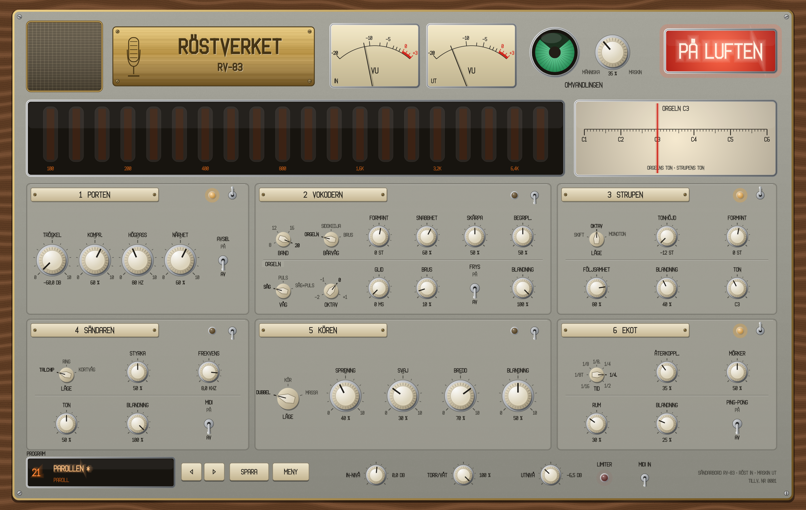
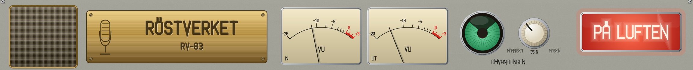
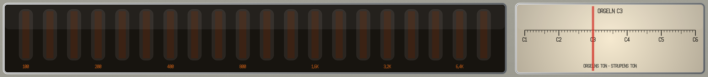
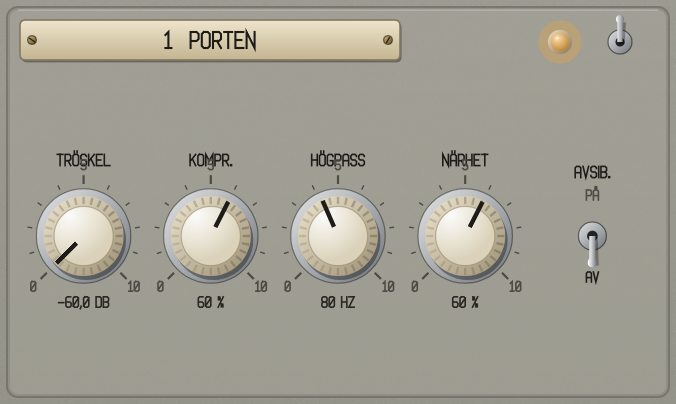
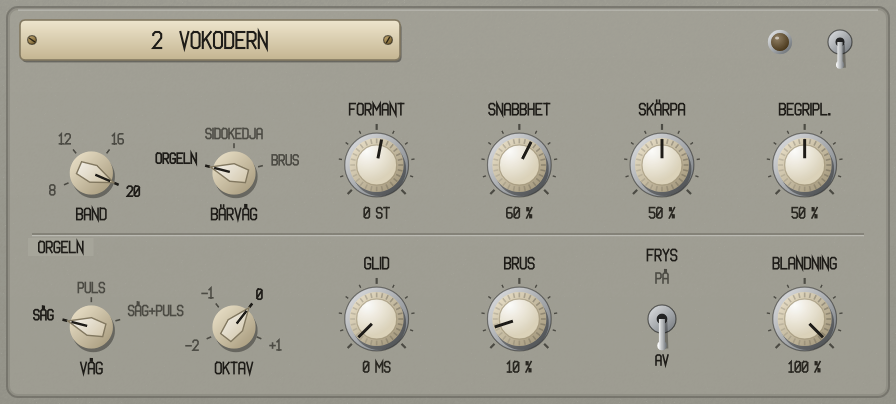
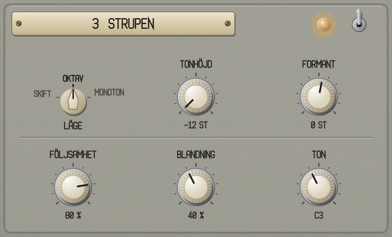
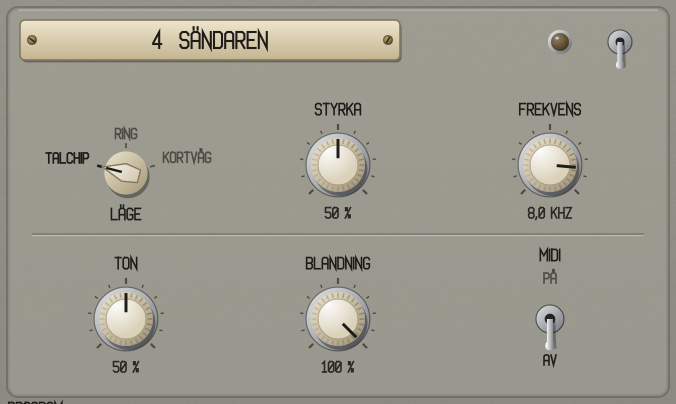
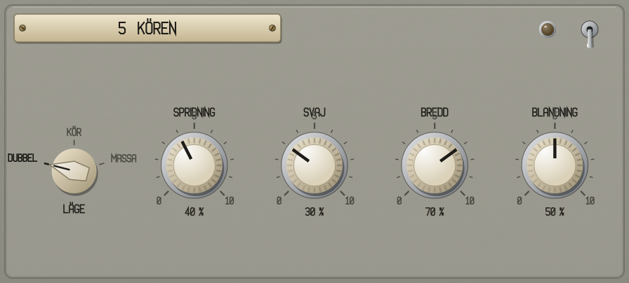
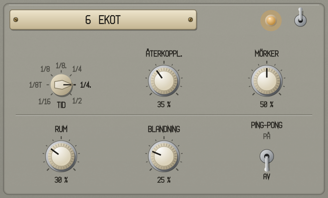
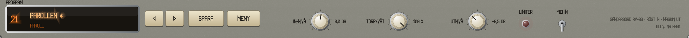

# Röstverket RV-83 – manual

*Sändarbordet i radiohuset: en effekt som gör en röst till vokoder, robot, kör eller paroll.* Röstverket läggs som insert på ett röstspår. Rösten går genom sex moduler i fast ordning: Porten, Vokodern, Strupen, Sändaren, Kören och Ekot. Makrospaken **Omvandlingen** drar alla påslagna moduler från människa mot maskin.

**Innehåll:** [Snabbstart](#snabbstart) · [Panelen och reglagen](#panelen-och-reglagen) · [Toppen](#toppen) · [1 Porten](#1-porten) · [2 Vokodern och Orgeln](#2-vokodern-och-orgeln) · [3 Strupen](#3-strupen) · [4 Sändaren](#4-sändaren) · [5 Kören](#5-kören) · [6 Ekot](#6-ekot) · [Omvandlingen](#omvandlingen) · [Utgången](#utgången) · [MIDI och sidokedjan](#midi-och-sidokedjan) · [Appen](#appen) · [Programmen](#programmen) · [Recept](#recept) · [Felsökning](#felsökning)

Hur Röstverket används i Reaper står i [Röstverket i Reaper](Rostverket_i_Reaper.md).

---

## Snabbstart

1. Lägg **Röstverket** (VST3) som insert på ett spår med en röst.
2. Klicka på programfönstret nere till vänster och välj ett program, till exempel *Robot → Maskinmänniskan* eller *Paroll → Parollen*.
3. Spela upp. Bläddra med **◀** och **▶**. Programmen ligger ungefär lika starkt, så att du kan bläddra utan att nivån hoppar.
4. Vrid på **OMVANDLINGEN** uppe i mitten för att göra rösten mer maskin. Det magiska ögat sluts mot maskin.
5. För vokoder med ackord: slå på **MIDI IN** nere till höger och spela toner på spåret. Orgeln bär då vokodern.
6. Spara med **SPARA**. Ditt program hamnar under *Egna*.

---

## Panelen och reglagen

| Reglage | Så gör du |
| --- | --- |
| **Ratt** | Dra upp eller ned. Håll **Skift** för fin inställning. Rulla med mushjulet. **Dubbelklick** ger grundvärdet. |
| **Vridomkopplare** | **Klick** = nästa läge, **Skift-klick** = förra, rulla, **högerklick** = lista. |
| **Vippa** | Klick växlar. Varje modul har en vippa (PÅ/AV) och en lampa uppe till höger. En avstängd modul räknar inte. |
| **Tonskalan** | Klick sätter Orgelns ton där du klickar. Dra upp eller ned för att finjustera. |
| **PÅ LUFTEN** | Klick: släckt betyder förbikopplat, och ljudet går igenom orört. Det är samma sak som DAW:ens bypass. |

**MENY** har **Storlek** (60–160 %, 85 % från början) och **Visa mappen med egna program**. I appen finns också mikrofonen, ljudkortet och inspelaren (se [Appen](#appen)). Storleken ändras också genom att dra i hörnet, och den sparas med projektet.

---

## Toppen

- **VU IN / VU UT:** nivån in och ut.
- **Det magiska ögat och OMVANDLINGEN:** makrospaken (se [Omvandlingen](#omvandlingen)). Ögat är vidöppet vid människa och slutet vid maskin.
- **PÅ LUFTEN:** lyser när bordet sänder.

- **Bandmätaren:** 20 glimrör som visar vokoderns band, från 100 Hz till 8 kHz. Rör som inte används är släckta (vid 8, 12 eller 16 band). Står FRYST i hörnet är banden frysta.
- **Tonskalan:** Orgelns ton – den senaste MIDI-tonen, eller TON när MIDI in är av.

---

## 1 Porten

Städar rösten innan den går in i maskinen.

| Reglage | Vad det gör |
| --- | --- |
| **TRÖSKEL** | Grinden: rummets brus under tröskeln stängs ute (−80 till 0 dB, grundvärde −60 dB). Öppnar på 1 ms och stänger på 60 ms. |
| **KOMPR.** | Kompression i en ratt: tröskel −12 till −30 dB och förhållande 1:1 till 6:1, med påfyllnad. |
| **HÖGPASS** | Tar bort muller och brum (40–300 Hz, grundvärde 80 Hz). |
| **NÄRHET** | En topp på 3,2 kHz, upp till +8 dB. Rösten kommer närmare. |
| **AVSIB.** | Avsibilant: tar ner s-ljuden med upp till 10 dB. Gäller bara den torra vägen – vokodern får s-ljuden orörda, så att orden hörs. |

---

## 2 Vokodern och Orgeln

Vokodern delar rösten i band och låter en bärvåg tala med rösten. Bärvågen är den inbyggda Orgeln, pluginets sidokedja eller brus.

| Reglage | Vad det gör |
| --- | --- |
| **BAND** | 8, 12, 16 eller 20 band. Färre band låter grövre och mer robot. |
| **BÄRVÅG** | **ORGELN** (den inbyggda, se nedan), **SIDOKEDJA** (pluginets ingång 3/4, till exempel en bas) eller **BRUS** (viskning). |
| **FORMANT** | Flyttar banden uppåt (liten, ljus röst) eller nedåt (jätte), −12 till +12 st. |
| **SNABBHET** | Hur fort banden följer rösten. Högt ger tydligt tal, lågt ger en mjuk yta. |
| **SKÄRPA** | Bandens bredd. Hög skärpa ger smalare band och en mer metallisk ton. |
| **BEGRIPL.** | Begriplighet: s, f och t blandas in direkt från rösten, så att orden hörs. |
| **FRYS** | Håller banden som de är. En stavelse blir en ton som Orgeln kan spela. |
| **BLANDNING** | Vokoder mot torr röst. |

**Orgeln** (raden ORGELN) är den inbyggda bärvågen, åtta stämmor från MIDI:

| Reglage | Vad det gör |
| --- | --- |
| **VÅG** | **SÅG**, **PULS** eller **SÅG+PULS**. |
| **OKTAV** | −2 till +1. |
| **GLID** | Glid mellan toner, 0–1 000 ms. |
| **BRUS** | Brus i bärvågen. Det hjälper konsonanterna. |
| **TON** (på tonskalan) | Tonen Orgeln håller när MIDI in är av. |

Utan ton är vokodern tyst: med MIDI in på hörs ingenting förrän du spelar en ton.

---

## 3 Strupen

Tonhöjd och formant var för sig.

| Reglage | Vad det gör |
| --- | --- |
| **LÄGE** | **SKIFT**: tonhöjd och formant flyttas. **OKTAV**: den förskjutna rösten blandas med den torra – parollrösten. **MONOTON**: rösten dras till en enda ton – roboten. |
| **TONHÖJD** | −12 till +12 st (SKIFT och OKTAV). |
| **FORMANT** | −12 till +12 st, utan att tonen ändras. |
| **FÖLJSAMHET** | I MONOTON: hur hårt rösten dras till tonen. |
| **BLANDNING** | Den förskjutna rösten mot den torra. |
| **TON** | Tonen i MONOTON. |

Strupen ger Röstverket en fast latens på 25 ms, som DAW:en kompenserar för.

---

## 4 Sändaren

| Läge | Vad det gör | FREKVENS |
| --- | --- | --- |
| **TALCHIP** | Datorrösten: grov sampling utan filter och 8 till 4 bitar (STYRKA). | Samplingstakten, 4–16 kHz |
| **RING** | Metallrösten: ringmodulator. STYRKA går från en del av rösten kvar till ren ring. Med **MIDI** på följer ringen senaste MIDI-ton. | Ringens ton, 20–2 000 Hz |
| **KORTVÅG** | Rösten på avstånd: ett smalt band som fädar, en vissling och brus. STYRKA gör bandet smalare. | Visslingen, 300–4 000 Hz |

**TON** gör ljudet mörkare eller ljusare. **BLANDNING** blandar Sändaren mot rösten.

---

## 5 Kören

| Reglage | Vad det gör |
| --- | --- |
| **LÄGE** | **DUBBEL** (en röst till), **KÖR** (tre till) eller **MASSA** (sju till). |
| **SPRIDNING** | Hur långt isär rösterna ligger i tid. |
| **SVAJ** | Rösternas tonhöjdssvaj, upp till ±12 ct. |
| **BREDD** | Hur brett rösterna sprids i stereo. |
| **BLANDNING** | Kören mot den torra rösten. |

---

## 6 Ekot

| Reglage | Vad det gör |
| --- | --- |
| **TID** | 1/16 till 1/2 i DAW:ens tempo, prickad och triol. |
| **ÅTERKOPPL.** | Hur många gånger ekot kommer tillbaka (0–95 %). |
| **MÖRKER** | Varje eko blir mörkare. |
| **RUM** | Ett litet studiorum. |
| **BLANDNING** | Ekot och rummet mot rösten. |
| **PING-PONG** | Ekot studsar mellan vänster och höger. |

---

## Omvandlingen

Makrospaken drar alla **påslagna** moduler från människa mot maskin. Nivån hålls ungefär.

| Modul | Vad spaken gör |
| --- | --- |
| Vokodern | Mer vokoder, snabbare och skarpare band |
| Strupen | Rösten följer tonen hårdare (MONOTON) |
| Sändaren | Mer styrka och mer Sändare i blandningen |
| Kören | Tätare: mindre spridning och svaj |

---

## Utgången

| Reglage | Vad det gör |
| --- | --- |
| **IN-NIVÅ** | −24 till +24 dB in i bordet. |
| **TORR/VÅT** | Hela bordet mot den torra rösten. |
| **UTNIVÅ** | −24 till +12 dB. Programmen använder den för att ligga lika starkt. |
| **LIMITER** | En toppbegränsare på −0,3 dBFS sist. Lampan lyser när den tar i, och ett klick slår av den. |
| **MIDI IN** | På: Röstverket lyssnar på MIDI (Orgeln och Sändarens ring). Av: Orgeln håller TON. |

---

## MIDI och sidokedjan

- **MIDI:** slå på **MIDI IN**. Tonerna spelar Orgeln (åtta stämmor), och med Sändarens **MIDI** på också ringmodulatorn. MIDI IN sparas med projektet men inte i programmen.
- **Sidokedjan:** ingång 3/4 (VST3 och CLAP) är vokoderns bärvåg i läget **SIDOKEDJA**. Skicka en synt eller en bas dit. I AU finns ingen sidokedja; använd Orgeln eller brus.

---

## Appen

Röstverket finns också som fristående app. Under **MENY** finns:

- **Mikrofonen på** – av från början, så att det inte blir rundgång. Använd hörlurar.
- **Ljud och MIDI …** – ljudkort, in- och utgångar och MIDI-ingång (till exempel en klaviatur till Orgeln).
- **Spela in utgången** / **Stoppa inspelningen** – inspelningen hamnar som WAV (24 bit) och MIDI i `~/Music/Röstverket/`.
- **Visa inspelningarna**.

Programfönstret visar om mikrofonen är på och hur länge inspelningen har pågått.

---

## Programmen

Klicka på programfönstret för listan per kategori. En stjärna efter namnet betyder att programmet är ändrat.

| Kategori | Program |
| --- | --- |
| Grund | Init |
| Robot | Maskinmänniskan, Monoton order, Talchippet, Ringrösten, Robot i schaktet, Kall kalkylator |
| Vokoder | Sågtandskör, Mässingsmaskin, Viskningen, Basen talar (sidokedjan), Åtta band, Glidande orgel, Spöket i vokodern |
| Kör | Dubbelröst, Kören i hallen, Massan marscherar, Oktav under, Oktav över, Munkarna |
| Paroll | Parollen, Från talarstolen, Ledaren talar, Massmötet, Högtalaren på torget, Marschorder |
| Radio | Kortvåg från öst, Nattsändning, Störsändaren, Sifferstationen |

Programmen med vokoder håller en ton på TON. Slå på MIDI IN och spela, så tar MIDI över. *Basen talar* behöver en bärvåg i sidokedjan.

Egna program sparas i `~/Library/Application Support/Rostverket/Program/` (`.rvprog`). Ett eget program som får samma namn som ett fabriksprogram sparas med tillägget "(eget)".

---

## Recept

- **Robotrösten:** *Monoton order*. Ställ Strupens **TON** på låtens grundton och dra **OMVANDLINGEN** uppåt.
- **Vokoder med ackord:** *Sågtandskör*, slå på **MIDI IN** och lägg ett MIDI-objekt med ackord på samma spår som rösten.
- **Synten talar:** *Basen talar*. Skicka en synt eller en bas till Röstverkets ingång 3/4.
- **Parollen:** *Parollen*, eller *Marschorder* för en hårdare variant.
- **Frusen stavelse:** en vokoder, och slå på **FRYS** på en vokal. Spela sedan melodin från MIDI.
- **Viskningen:** *Viskningen*. Höj **BEGRIPL.** om orden försvinner.

---

## Felsökning

| Det händer | Gör så här |
| --- | --- |
| Pluginet syns inte i Reaper | *Options → Preferences → Plug-ins → VST → Re-scan*. |
| Vokodern är tyst | MIDI IN är på men inga toner spelas, eller BÄRVÅG står på SIDOKEDJA utan signal. Slå av MIDI IN (Orgeln håller TON) eller spela toner. |
| Rösten ligger 25 ms sent | Strupens latens. DAW:en kompenserar om fördröjningskompensationen är på (i Reaper är den det från början). |
| Orden försvinner i vokodern | Höj **BEGRIPL.** och **SNABBHET**, och ge Orgeln lite **BRUS**. |
| Det tjuter i appen | Mikrofonen och högtalarna hör varandra. Använd hörlurar, eller stäng av mikrofonen under MENY. |
| Ingen sidokedja i Logic | AU-versionen har ingen sidokedja. Använd VST3 eller CLAP i Reaper, eller Orgeln. |
